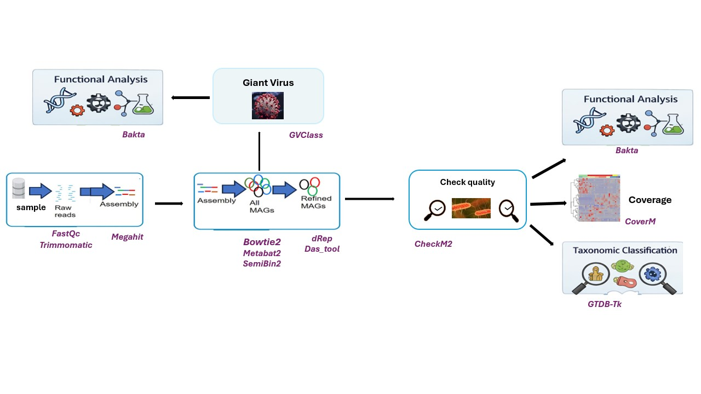

# Metagenomic MAG Reconstruction Pipeline



This repository provides a reproducible pipeline for the reconstruction and analysis of metagenome-assembled genomes (MAGs) from metagenomic sequencing data.
It covers all major steps of the workflow, from raw read processing to taxonomic and functional annotation.

## Workflow Overview

The pipeline includes:

- **Preprocessing of metagenomic data**: quality control, read trimming
- **Read assembly**: MEGAHIT
- **Combined assembly**
- **Assembly index** : Bowtie2
- **Reads mapping**: Bowtie2, samtools
- **Genome binning**: MetaBAT2, SemiBin2
- **Bin refinement**: DAS Tool
- **MAG dereplication**: dRep
- **MAG quality assessment**: CheckM2
- **Taxonomic assignment**: GTDB-Tk
- **Giant Virus detection**: GVClass
- **Functional annotation**: Bakta
- **MAG abundance estimation**: CoverM


## Repository Structure

```text
Internship_M2_Hornes/
├── README.md                               # Project overview
├── image/
│   └── figure_analyse.png                  # Workflow diagram
└── Workflows/
    ├── MAGs_pipeline.md                    # Complete pipeline documentation
    ├── software_database_versions.md       # Software and database versions
    ├── env_pipeline.yaml                   # Conda environment
    └── scripts/
        ├── 01_concat_fasta.sh              # Assembly concatenation
        ├── 02_das_tool_prepare.sh          # DAS Tool preparation
        ├── 03_bakta_loop.sh                # Functional annotation
        ├── 04_genome_def.sh                # Genome definition
        ├── 05_filter_quality_mag.sh        # MAG quality filtering
        ├── 06_extract_resistance_virulence.sh
        └── 07_script_visualisation.R       # Figures generation
```

For detailed commands and parameters, see the [Full Pipeline Documentation](Workflows/MAGs_pipeline.md).

For tool versions and database details, see the [Software and Database Versions](Workflows/software_database_versions.md).


## Reproducibility

The R environment used to generate the figures is available in: [R session information](Workflows/R_sessionInfo.txt)

This file contains the complete R version, package versions, and system information used during the analyses.


---

## Tools and References

| Tool | Reference / DOI |
|------|----------------|
| FastQC | [FastQC website](https://www.bioinformatics.babraham.ac.uk/projects/fastqc/) |
| Trimmomatic | [Bolger et al., 2014](https://doi.org/10.1093/bioinformatics/btu170) |
| MEGAHIT | [Li et al., 2015](https://doi.org/10.1093/bioinformatics/btv033) |
| Bowtie2 | [B Langmead., 2012](https://doi.org/10.1038/nmeth.1923)|
| Samtools | [Danecek et al., 2021](https://doi.org/10.1093/gigascience/giab008) |
| MetaBAT2 | [Kang et al., 2019](https://doi.org/10.7717/peerj.7359) |
| SemiBin2 | [Pan et al., 2023](https://doi.org/10.1093/bioinformatics/btad209) |
| DAS Tool | [Sieber et al., 2018](https://doi.org/10.1038/s41564-018-0171-1) |
| dRep | [Olm et al., 2017](https://doi.org/10.1038/ismej.2017.126) |
| CheckM2 | [Chklovski et al., 2023](https://doi.org/10.1038/s41592-023-01940-w) |
| GTDB-Tk | [Chaumeil et al., 2019](https://doi.org/10.1093/bioinformatics/btz848) |
| GVClass | [Pitot et al., 2024](https://doi.org/10.1038/s44298-024-00069-7)| 
| Bakta | [Schwengers et al., 2021](https://doi.org/10.1099/mgen.0.000685) |
| CoverM | [Aroney et al., 2025](https://doi.org/10.1093/bioinformatics/btaf147) |
| R | [R Core Team, 2021](https://www.R-project.org/) |


